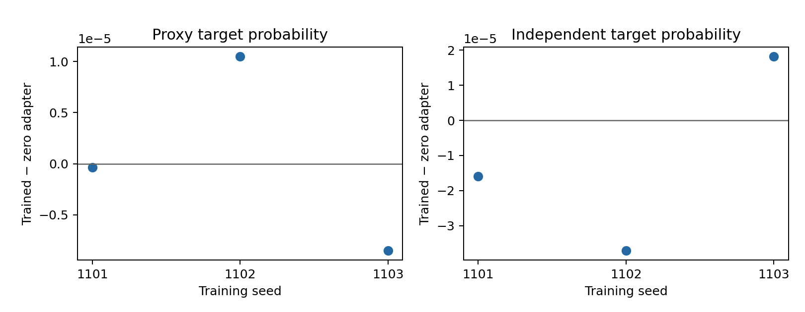
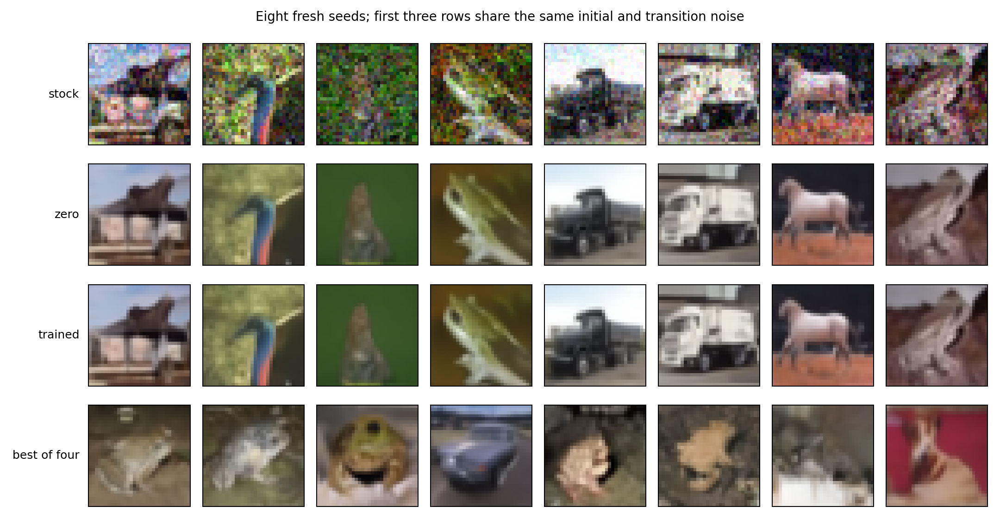

# A real checkpoint, a tiny policy update, and two ways diffusion RL can mislead

I fine-tuned a released image diffusion model with group-relative reinforcement learning. The code passed its probability checks, the adapter moved, and 36 groups of generated images supplied nonzero training advantages. On fresh samples, the measured improvement was effectively zero. A parallel toy-video experiment stopped even earlier: its generator made no detectable digits, while a motion reward still paid for two clips. Those are the two results of this study.

The question was whether an online policy update could raise a chosen score **without making the outputs worse in ways that score missed**. I had previously tested a related idea on [RFdiffusion3 protein backbones](../rfd3_flow_benchmark/BLOG_POST.md). This time I used Google's released [CIFAR-10 DDPM](https://huggingface.co/google/ddpm-cifar10-32) for the completed image experiment and a released [Moving-MNIST flow checkpoint](https://huggingface.co/kuterd/moving_mnist_diffusion) for the video feasibility test. Everything ran on a 16 GB M3 laptop.

## Turning denoising into a policy

[DDPO](https://arxiv.org/abs/2305.13301) frames denoising as a sequence of decisions. I kept the 35.7-million-parameter CIFAR denoiser frozen and added a zero-initialized, 2,627-parameter convolutional residual to its predicted noise. A 50-step **stochastic DDIM** sampler used that prediction to define a Gaussian distribution for each nonterminal next state. I recorded the sampled transitions and their conditional log densities. The density is exact for a transition under **this modified sampler**; it is not the likelihood of the final image.

Each update sampled four siblings, scored their final images, and standardized their rewards within the group. A sibling above its group mean got a positive advantage; one below it got a negative advantage. I applied clipped new-versus-old conditional action ratios at three selected denoising steps, over two inner epochs, with a Gaussian reference-KL penalty. The ratio loss is a **clipped optimization surrogate**, not an exact policy-gradient evaluation or a guarantee of better images.

I checked the implementation before touching the full run. Seven numerical tests covered Gaussian densities, centered advantages, tied rewards, a zero-advantage update, update direction, zero-adapter identity, and frozen-backbone gradients. The MPS preflight generated four finite images and measured a zero log-ratio for the untrained adapter. The checkpoint revision and SHA-256, schedule, three training seeds, and 32 fresh evaluation seeds were fixed in the [protocol](PROTOCOL.json). A CPU optimizer smoke exposed large joint-action ratios; I reduced the learning rate to `1e-7` **before** the three full training runs, then left it fixed.

## Controls designed to catch a misleading win

The reward was a small classifier's probability that an image depicts a CIFAR-10 frog. It trained on 5,000 examples and reached 46.2% test accuracy, above the predeclared 40% gate. A different, larger classifier trained on the disjoint other 45,000 training images and reached 79.88% on the held-out test set, above its 60% gate. I used that second model only to evaluate generated images. This separation makes it possible to spot a reward increase that does not transfer to an independent judge.

The primary control was the **zero adapter under the same stochastic DDIM sampler**, paired by initial and transition noise. I also sampled the untouched checkpoint with a 50-step DDPM schedule, and selected the highest-reward image from four zero-adapter candidates. The DDPM schedule changes the sampling process, so stock-versus-trained is not an estimate of the RL effect. Best-of-four spends four times the sampling compute and uses different candidates; it shows what selection can buy without changing weights.

## The measured result

All three image training seeds completed 12 updates. Every one of the 36 groups had nonzero relative advantages. Adapter weights moved by about `3.6 × 10⁻⁵` in norm, but the largest logged absolute action log-ratio during training was only `0.00049`; no selected ratio was clipped. The update was real and very small.

On 32 fresh evaluation seeds, repeated for each of the three trained adapters, the paired **trained minus zero-adapter** effects were:

| Metric | Mean effect | Descriptive 95% seed-bootstrap interval |
|:--|--:|--:|
| Reward classifier frog probability | +0.00000055 | [−0.0000117, +0.0000146] |
| Independent classifier frog probability | −0.0000116 | [−0.000107, +0.000046] |
| Independent frog-class accuracy | 0.0000 | [0.0000, 0.0000] |

The independent accuracy did not change on any pair. A three-training-seed bootstrap is descriptive; it cannot rule out effects in a larger study. It does establish that this particular update did not produce a useful measured gain. Raw tensors, complete per-image scores, the bootstrap calculation, and a CPU re-score audit are available in the [results and audit trail](RESULTS.md). All 384 saved image samples were finite, and CPU re-scoring agreed with logged metrics to within `0.000006`.

The sampler choice mattered far more than the policy update. The zero-adapter DDIM run averaged **0.0706** on the reward classifier and **0.1557** independent frog probability; the trained run rounded to the same values. The stock DDPM reference averaged **0.4011** and **0.4312**, respectively. Best-of-four DDIM reached **0.1323** reward at four times the candidate cost. These numbers should not be collapsed into a single ranking of algorithms: the stock schedule differs, and selecting four candidates has a different compute budget. A small-sample Fréchet distance in the independent classifier's features and a pixel-distance diversity check showed no meaningful trained-versus-zero change. That Fréchet number is **not official FID**, and 32 generated images make it noisy.

The paired zero and trained rows are visually almost identical, consistent with the measured mean absolute pixel difference of roughly `0.00009–0.00015` across the three adapters. Some stock images are grainier, but this grid is a qualitative check, not a substitute for the paired numbers.

## Why I did not run video GRPO

The Moving-MNIST checkpoint is a small flow-matching model. Its released sampler is deterministic and scales the predicted velocity by one tenth. I tested a separately labeled noisy Euler sampler with Gaussian conditional actions and the unscaled velocity suggested by its training target. This is **not** the [Flow-GRPO](https://arxiv.org/abs/2505.05470) paper's marginal-equivalent ODE-to-SDE construction for its model, nor is it equivalent to the released toy model's sampler. The stochastic actions would have tractable conditional densities, but that alone is not enough to make a sound training experiment.

On four predeclared four-frame seeds, the zero-adapter sampler produced no detectable digit components and zero independent digit confidence. Two clips nevertheless earned reward from motion alone. I also inspected the upstream sampler at four and twenty frames; those samples looked noise-like, while ordinary Euler at four frames tended toward black. These checks cannot determine whether the checkpoint or my shortened sampling setting is chiefly responsible. They **do** show that the planned reward could reward motion without digits. The [predeclared gate](VIDEO_GATE_FAILED.json) therefore stopped the video arm before any policy update. There is no video GRPO result to report.

## What transfers from the protein study, and what does not

In the [RFdiffusion3 study](../rfd3_flow_benchmark/BLOG_POST.md), a small adapter changed an EDM-style protein denoising policy but gave essentially zero change in the completed four-seed Cα geometry test. Here the image update also changed parameters without a useful measured reward shift. The mathematical policies differ: this image study uses stochastic DDIM transitions, the protein study used a variance-exploding reverse-SDE-style modification, and the stopped video arm would have used a modified stochastic flow sampler. None of those conditional action densities establishes a final-sample likelihood or equivalence to each stock sampler.

Larger models remain a resource question, not an extrapolated result. [Sana's hardware guide](https://github.com/NVlabs/Sana/blob/main/docs/installation.md) lists 9 GB for Sana-0.6B on tested A100 GPUs; the [CogVideoX training guide](https://huggingface.co/docs/diffusers/training/cogvideox) lists 47 GB for CogVideoX-2B LoRA fine-tuning at batch size one. An inference memory figure does not show that multi-rollout GRPO training fits a 16 GB laptop. The image result is about a compact pretrained DDPM; the failed gate is about this toy-video checkpoint and sampler, not modern cinematic video generation.

My next image experiment would prospectively choose a more expressive adapter or a reward whose gradient can move this sampler meaningfully, then retain the same paired and independent-evaluator checks. I would not call that a fix until it beats the zero adapter on fresh seeds. For video, I would first establish digit-bearing baseline clips and a reward that cannot be earned by moving noise. The two decisions are concrete consequences of this run: **a valid update is not evidence of an improved generator, and a reward is not useful until the baseline can produce the thing it is meant to reward.**
