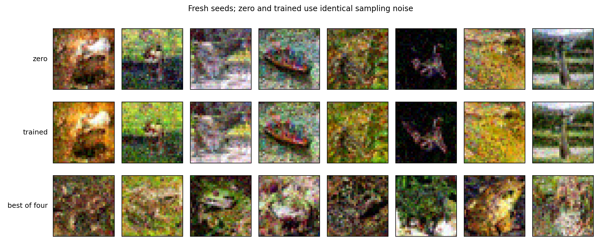

# When diffusion GRPO raises the reward but the image barely improves

I wanted to know whether a group-relative policy update could make a pretrained generator produce better images, rather than merely make a reward model happier. On a 16 GB M3 laptop, I fine-tuned a released [CIFAR-10 DDPM](https://huggingface.co/google/ddpm-cifar10-32) with a 2,627-parameter residual adapter while keeping its 35.7-million-parameter denoiser frozen. The final three-seed experiment raised the reward classifier's frog probability by **0.056** on fresh paired samples. A separate classifier, trained on disjoint data, improved by only **0.009** in frog probability; its uncertainty interval crossed zero. One of the three training seeds made its independent score worse. That is a useful result: the optimization worked on its chosen signal, but the evidence does not support claiming a better image generator.

This follow-up came after two null experiments. The [first study](BLOG_POST.md) used a 50-step stochastic DDIM policy and a weak reward classifier. Its update was tiny, and its zero-adapter sampler was substantially worse than the released DDPM sampler. The [second study](ddpm_followup/RESULTS.md) repaired that comparison: I matched the released 50-step DDPM scheduler, verified the zero adapter against the library scheduler step by step, and increased the update budget. Its trained-minus-zero effect was still uncertain: +0.012 proxy probability and +0.002 independent probability. Those failures shaped the third, prospectively fixed [protocol](strong_reward/PROTOCOL.json): keep the stock-matched sampler, train a better reward classifier, and use fresh seeds for a larger update.

## The policy and the experiment

[DDPO](https://arxiv.org/abs/2305.13301) supplies the key perspective: each stochastic reverse-diffusion transition is an action. For the released DDPM schedule, the denoiser and small residual adapter define a Gaussian mean for the next image state; the schedule fixes its variance. I recorded the actual sampled state, next state, and conditional Gaussian log density at every nonterminal step. That density is exact **for a conditional transition under this implemented policy**. It is not the likelihood of the final image.

Each training update generated four images from a shared setup, scored their final outputs, and standardized reward within that group. I applied a clipped new-versus-old action-likelihood ratio at three randomly chosen, stratified denoising steps over two optimization epochs, with a frozen-reference KL penalty. The 50-step backbone remained frozen; only the residual adapter changed. This is a **GRPO-style clipped surrogate** on selected diffusion actions, not an exact full-trajectory policy-gradient estimate. The image model is a DDPM, so I call this diffusion-policy GRPO rather than [Flow-GRPO](https://arxiv.org/abs/2505.05470), which was developed for flow-matching models. The earlier [RFdiffusion3 protein study](../rfd3_flow_benchmark/BLOG_POST.md) used a different, variance-exploding reverse-SDE-style modification. Neither study establishes that its modified stochastic sampler has the same finite-step distribution as the released deterministic or stock process.

The stronger proxy classifier and independent evaluator trained on separate 25,000-image halves of the CIFAR-10 training set. They reached **81.66%** and **81.46%** on the held-out CIFAR-10 test set, above a 70% gate set before RL. The independent model supplied no gradient or reward during training. I fixed three adapter-training seeds, 250 groups of four per seed, 32 fresh paired evaluation seeds, and the stopping rules before running. A zero adapter under the *same* DDPM sampler is the causal baseline. Best-of-four chooses the highest-proxy-reward image from four zero-adapter samples at four times the generation cost; it asks whether selection beats a weight update when compute is available.

## What changed on fresh images

| Trained minus zero adapter | Mean across three runs | Descriptive 95% hierarchical interval |
|:--|--:|--:|
| Proxy frog probability | +0.0559 | [+0.0004, +0.1291] |
| Independent frog probability | +0.0089 | [−0.0560, +0.0722] |
| Independent frog accuracy | +0.0208 | [−0.0729, +0.1250] |

The proxy effect was positive in all three runs: +0.046, +0.105, and +0.017. The independent probability effects were +0.020, +0.056, and **−0.049**. With three training seeds, the interval is descriptive, not a population-level guarantee. The 32 zero-adapter images are shared controls across runs, so I resampled paired evaluation-seed indices jointly instead of counting the same control images as three independent datasets.

The quality checks temper the proxy result. The independent classifier's feature-Fréchet diagnostic increased from **18.263** for the zero adapter to **18.490**, **18.482**, and **20.776** for the trained runs; lower would have been better. It uses only 32 generated images against 500 real frogs, so it is noisy and **not official FID**. Pixel diversity moved from 35.445 to 35.685, 34.056, and 34.234. The sample grid shows subtle changes between paired zero and trained images, not a striking visual improvement. By contrast, best-of-four reached **0.957** proxy probability and **1.000** independent frog accuracy on this small 32-seed set, from 0.624 and 0.750 for the zero adapter. That is a selection result at four times the inference cost, not a fair equal-compute GRPO win.

The optimizer did move the adapter: final parameter-difference norms were about 0.039–0.040, compared with roughly 0.00004 in the first experiment. The maximum logged action log-ratio stayed below 0.045 and no selected ratio was clipped. The absence of clipping is reassuring for stability but also means the improvement did not come from using the clipping boundary aggressively. Ten numerical tests passed, including Gaussian-density, zero-advantage, frozen-backbone, and released-DDPM transition checks. Every saved image was finite and CPU re-scoring agreed with logged probabilities to within 0.000005. The [full results](strong_reward/RESULTS.md), [paired effects](strong_reward/EFFECTS.json), [raw-sample audit](strong_reward/AUDIT.json), and [protocol](strong_reward/PROTOCOL.json) let a reader check those claims.

## Why the video arm stopped

I also revisited the pretrained [Moving-MNIST video checkpoint](https://huggingface.co/kuterd/moving_mnist_diffusion). The first feasibility test had shortened the model's 20-frame input to four frames and used an eight-step noisy sampler. It produced no detected digits, so I had correctly stopped before video GRPO. I then checked the [upstream training code](https://github.com/kuterd/toy_video_dit/blob/d5c2ae0dee8ccd90fe50d8cffbcb0ef4b4126f8a/train.py) and [released sampling code](https://github.com/kuterd/toy_video_dit/blob/d5c2ae0dee8ccd90fe50d8cffbcb0ef4b4126f8a/sampling.py), fixed four new seeds in advance, and ran native 20-frame, 100-step deterministic inference.

All four native clips failed the digit-content gate and looked like noise. Their output pixels remained **0.9983 correlated with the initial uniform noise**. Code inspection found a concrete inconsistency: training predicts `data − noise`, but the released sampler traverses decreasing noise levels with `(sigma − sigma_prev) × prediction / 10`. That update has the opposite sign to the denoising direction implied by the training target and attenuates the step by ten. I declared a separate corrected-Euler diagnostic, flipping the sign and removing `/10`; its first two paired clips still looked like noise and failed. Because the gate required at least three of four successes, two early failures made passing impossible, so I stopped. The pinned file is named `moving_mnist_epoch_79.pth`, while its internal checkpoint metadata reports **epoch 4**. This does not prove what happened upstream, but it prevents treating the filename and model-card training claim as verified by the file. The [video audit](video_revisit/AUDIT.json) records hashes, per-clip metrics, and noise correlations. A digit classifier gave high confidence on visibly noisy clips, another reminder that a single reward signal can fail outside its training distribution.

There is **no video GRPO training result** here. The corrected Euler sampler is a diagnostic modification, not the released sampler or Flow-GRPO's construction. This toy checkpoint failure says nothing about cinematic video models. Published hardware requirements also put those models outside this laptop study: [Sana's installation guide](https://github.com/NVlabs/Sana/blob/main/docs/installation.md) gives an inference figure for one tested GPU setup, while [CogVideoX's training guide](https://huggingface.co/docs/diffusers/training/cogvideox) gives a much larger LoRA training requirement. Inference memory is not a GRPO-training budget, especially with multiple rollouts.

The next credible image experiment needs an objective that transfers across judges, more training seeds, and a quality metric with enough samples to be stable. The next video experiment needs a checkpoint whose *unmodified* inference produces recognizable moving digits before adding stochastic transitions or policy gradients. This project made progress by testing those prerequisites and by refusing to convert a higher proxy score into a stronger claim than the independent measurements support.

**Subsequent toy-video experiment:** I later built a [factorized digit-and-motion generator](video_factorized/VIDEO_RESCUE_BLOG_POST.md) that passes a content gate and permits actual video-scored diffusion GRPO training. Its motion is procedural rather than learned. Four trained adapters did not show a reproducible quality gain; the [audited results](video_factorized/RESULTS.md) keep this distinct from the failed learned-video checkpoint discussed above.
