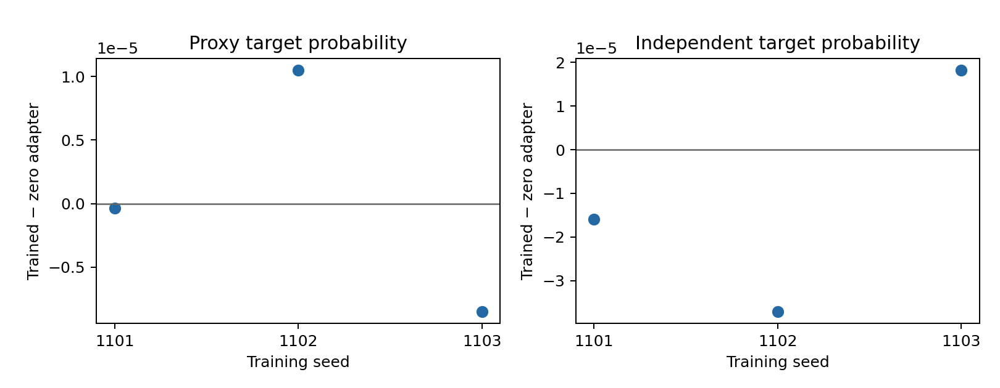
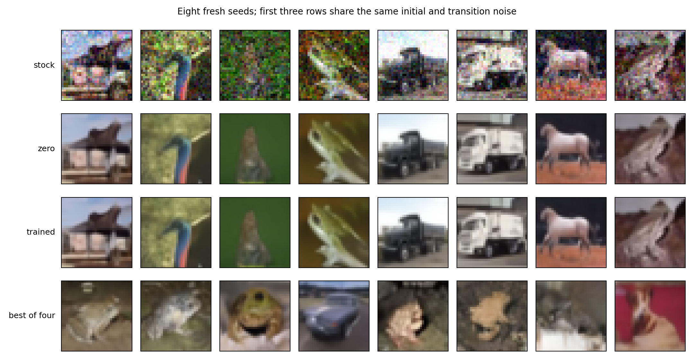

# Measured image/video GRPO results

The primary comparison is trained versus zero adapter under the same stochastic sampler and paired fresh seeds. Stock DDPM uses a different timestep schedule; best-of-four spends four times as many samples. These are contextual baselines.

## Image: pretrained CIFAR-10 DDPM

Three training seeds; 32 fresh evaluation seeds per run. Target class: frog. The checkpoint and raw artifacts are pinned in `PROTOCOL.json`.

| Metric | Trained − zero, pooled mean | Hierarchical seed-bootstrap 95% interval |
|---|---:|---:|
| reward | +0.000001 | [-0.000012, +0.000015] |
| gold_probability | -0.000012 | [-0.000107, +0.000046] |
| gold_accuracy | +0.000000 | [+0.000000, +0.000000] |

The interval resamples three training seeds and the 32 paired evaluation seeds, with each evaluation-seed index shared across the selected trained adapters. Only three training seeds were run, so the interval is descriptive rather than a strong population-level confidence statement. Stock, zero, and best-of-four use the same evaluation seeds in every run; their repeated table rows are shared controls, not independent replications.

| Training seed | Policy | Proxy reward | Gold probability | Gold accuracy | Feature Fréchet | Pixel diversity |
|---:|---|---:|---:|---:|---:|---:|
| 1101 | stock | 0.40108 | 0.43125 | 0.46875 | 9.831 | 35.412 |
| 1101 | zero | 0.07057 | 0.15572 | 0.15625 | 28.208 | 31.503 |
| 1101 | trained | 0.07057 | 0.15570 | 0.15625 | 28.206 | 31.503 |
| 1101 | best_of_four | 0.13232 | 0.17686 | 0.21875 | 13.221 | 28.824 |
| 1102 | stock | 0.40108 | 0.43125 | 0.46875 | 9.831 | 35.412 |
| 1102 | zero | 0.07057 | 0.15572 | 0.15625 | 28.208 | 31.503 |
| 1102 | trained | 0.07058 | 0.15568 | 0.15625 | 28.205 | 31.502 |
| 1102 | best_of_four | 0.13232 | 0.17686 | 0.21875 | 13.221 | 28.824 |
| 1103 | stock | 0.40108 | 0.43125 | 0.46875 | 9.831 | 35.412 |
| 1103 | zero | 0.07057 | 0.15572 | 0.15625 | 28.208 | 31.503 |
| 1103 | trained | 0.07056 | 0.15573 | 0.15625 | 28.207 | 31.504 |
| 1103 | best_of_four | 0.13232 | 0.17686 | 0.21875 | 13.221 | 28.824 |

Feature Fréchet is computed with 32 generated images versus 500 real target-class CIFAR-10 test images in the gold classifier's representation. It is not official FID and has high small-sample error. Pixel diversity is mean pairwise Euclidean distance and cannot alone establish perceptual variety.

## Video feasibility

The predeclared toy-video quality gate failed: All four predeclared four-frame zero-adapter feasibility samples had no detected digit components and zero independent MNIST digit confidence. Two of four still received nonzero reward solely from pixel motion, so the planned reward could be optimized without generating digits. No video GRPO training or benchmark improvement is claimed.

## Audit trail

Each completed run contains `train.jsonl`, adapter weights, `eval.jsonl`, per-policy raw sample tensors and visuals, a summary, and DONE markers. `AUDIT.json` records tensor hashes, finite-value checks, paired sample differences, and independent CPU score recomputation. Numerical checks are in `test_core.py`. Pretrained checkpoint revisions and SHA-256 hashes are in `PROTOCOL.json`. This is a laptop-scale method study, not a SOTA image/video benchmark.

Raw-sample audit: all 384 saved images have the expected 3×32×32 shape and finite values; maximum absolute CPU-versus-MPS score recomputation difference is 0.00000595. Mean absolute trained-versus-zero pixel differences by training seed are 0.00008761, 0.00015089, 0.00009686.
