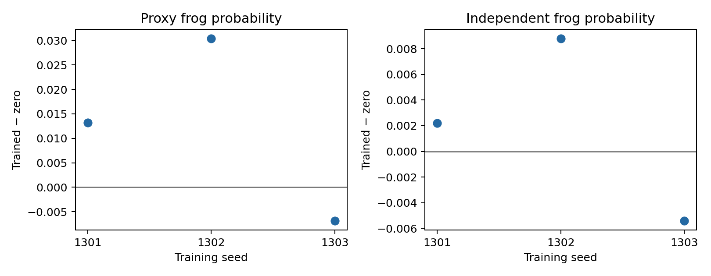
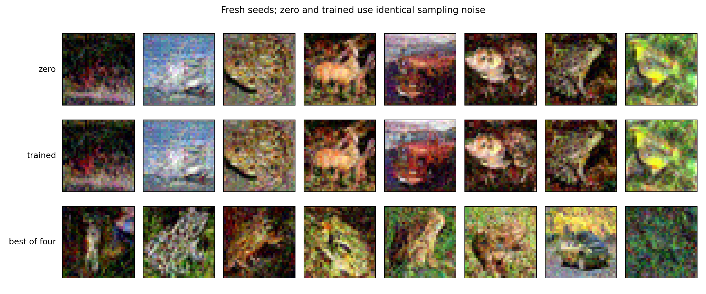

# Exploratory stock-DDPM GRPO follow-up

This study was motivated by the earlier null image result. It uses the released checkpoint's 50-step DDPM sampler for both zero and trained adapters, with fresh paired evaluation seeds. Best-of-four samples from the same zero-adapter policy at four times the sampling cost.

| Metric | Trained − zero mean | Descriptive hierarchical 95% bootstrap interval |
|---|---:|---:|
| reward | +0.012240 | [-0.008971, +0.036549] |
| gold_probability | +0.001855 | [-0.040674, +0.038715] |
| gold_accuracy | -0.031250 | [-0.083333, +0.000000] |

The interval resamples three training seeds and the same 32 paired evaluation-seed indices jointly across runs. With only three training seeds, it is descriptive. Repeated zero controls are shared samples, not independent replications.

| Seed | Policy | Proxy reward | Independent probability | Independent accuracy | Feature Fréchet | Pixel diversity |
|---:|---|---:|---:|---:|---:|---:|
| 1301 | zero | 0.37070 | 0.41926 | 0.43750 | 7.517 | 35.551 |
| 1301 | trained | 0.38391 | 0.42145 | 0.40625 | 8.092 | 35.503 |
| 1301 | best_of_four | 0.64244 | 0.66314 | 0.81250 | 7.405 | 31.963 |
| 1302 | zero | 0.37070 | 0.41926 | 0.43750 | 7.517 | 35.551 |
| 1302 | trained | 0.40109 | 0.42805 | 0.40625 | 7.917 | 35.402 |
| 1302 | best_of_four | 0.64244 | 0.66314 | 0.81250 | 7.405 | 31.963 |
| 1303 | zero | 0.37070 | 0.41926 | 0.43750 | 7.517 | 35.551 |
| 1303 | trained | 0.36380 | 0.41384 | 0.40625 | 7.693 | 36.053 |
| 1303 | best_of_four | 0.64244 | 0.66314 | 0.81250 | 7.405 | 31.963 |

Feature Fréchet uses the independent classifier's representation on 32 samples versus 500 real CIFAR-10 frog images. It is a small-sample diagnostic, not official FID. Pixel diversity is mean pairwise Euclidean distance.

Every raw saved sample is finite, has shape 3×32×32, and was rescored on CPU; hashes and maximum discrepancies are in `AUDIT.json`. `EFFECTS.json` has the raw paired-effect summaries. Conditional DDPM transition log densities are exact for this policy; the clipped GRPO objective is a surrogate, and no final-image likelihood is claimed.
