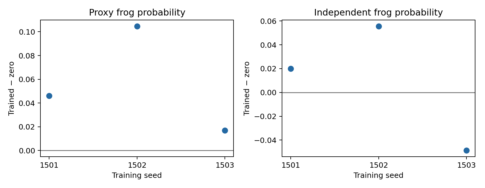
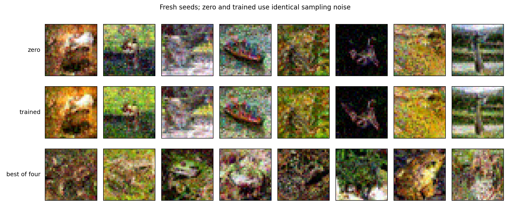
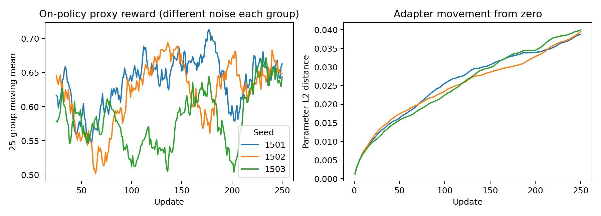

# Stronger-reward stock-DDPM GRPO follow-up

This exploratory study was motivated by two earlier null image studies and fixed new classifier splits and fresh seeds before training. It uses the released checkpoint's 50-step DDPM sampler for both zero and trained adapters, with fresh paired evaluation seeds. Best-of-four samples from the same zero-adapter policy at four times the sampling cost.

| Metric | Trained − zero mean | Descriptive hierarchical 95% bootstrap interval |
|---|---:|---:|
| reward | +0.055889 | [+0.000392, +0.129122] |
| gold_probability | +0.008931 | [-0.056027, +0.072152] |
| gold_accuracy | +0.020833 | [-0.072917, +0.125000] |

The interval resamples three training seeds and the same 32 paired evaluation-seed indices jointly across runs. With only three training seeds, it is descriptive. Repeated zero controls are shared samples, not independent replications.

| Seed | Policy | Proxy reward | Independent probability | Independent accuracy | Feature Fréchet | Pixel diversity |
|---:|---|---:|---:|---:|---:|---:|
| 1501 | zero | 0.62435 | 0.68489 | 0.75000 | 18.263 | 35.445 |
| 1501 | trained | 0.67053 | 0.70486 | 0.78125 | 18.490 | 35.685 |
| 1501 | best_of_four | 0.95718 | 0.95032 | 1.00000 | 16.465 | 31.834 |
| 1502 | zero | 0.62435 | 0.68489 | 0.75000 | 18.263 | 35.445 |
| 1502 | trained | 0.72899 | 0.74048 | 0.84375 | 18.482 | 34.056 |
| 1502 | best_of_four | 0.95718 | 0.95032 | 1.00000 | 16.465 | 31.834 |
| 1503 | zero | 0.62435 | 0.68489 | 0.75000 | 18.263 | 35.445 |
| 1503 | trained | 0.64119 | 0.63614 | 0.68750 | 20.776 | 34.234 |
| 1503 | best_of_four | 0.95718 | 0.95032 | 1.00000 | 16.465 | 31.834 |

Feature Fréchet uses the independent classifier's representation on 32 samples versus 500 real CIFAR-10 frog images. It is a small-sample diagnostic, not official FID. Pixel diversity is mean pairwise Euclidean distance.

Every raw saved sample is finite, has shape 3×32×32, and was rescored on CPU; hashes and maximum discrepancies are in `AUDIT.json`. `EFFECTS.json` has the raw paired-effect summaries. Conditional DDPM transition log densities are exact for this policy; the clipped GRPO objective is a surrogate, and no final-image likelihood is claimed.

## Reward-model and update diagnostics

The proxy and disjoint evaluator reached 81.66% and 81.46% CIFAR-10 test accuracy. Both were trained for the predeclared 16 epochs on separate 25,000-example subsets; no evaluator weights entered GRPO.

| Seed | Early 50 on-policy reward | Late 50 on-policy reward | Final adapter delta norm | Max action log-ratio | Max clip fraction |
|---:|---:|---:|---:|---:|---:|
| 1501 | 0.5995 | 0.6567 | 0.0388 | 0.0449 | 0.000 |
| 1502 | 0.5993 | 0.6454 | 0.0395 | 0.0366 | 0.000 |
| 1503 | 0.5786 | 0.6508 | 0.0400 | 0.0378 | 0.000 |

The on-policy curve is a noisy training diagnostic, not a paired evaluation. The paired fresh-seed effects and independent classifier above determine the outcome.

