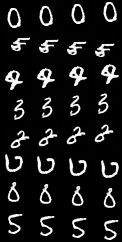
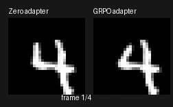
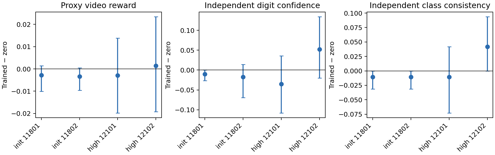

# I made the toy videos recognizable. That did not make video GRPO a win.

My first video-GRPO attempt could not get past sampling. The released Moving-MNIST checkpoint produced noise-like clips under both its native sampler and a correction I tested, so training a policy on those clips would have made the experiment hard to interpret. I tried two local four-frame video denoisers on the same laptop. They drew digit-like frames, but their fixed-seed content and motion gates passed only 0/8, 2/8 and 1/8 clips across the temporal, joint and velocity-conditioned variants. I preserved those failures rather than calling a high classifier score on noisy output “working video generation.”

I then narrowed the question. A pretrained MNIST image diffusion model can already generate digits. I sampled **one** digit and translated that same image over four frames using a known velocity. This factorized generator made recognizable toy clips; six of eight prospective feasibility samples passed independent digit, ink and motion checks. The filmstrip is worth inspecting before the statistics: the same digit stays present while it moves. The motion is prescribed by an affine renderer, not learned by a video model. That distinction is central to the result.

This construction let me run a real video-scored policy experiment on a 16 GB M3 laptop. Following the [DDPO view of diffusion as a sequence of decisions](https://arxiv.org/abs/2305.13301), I treated each stochastic reverse step of the canonical-image sampler as a Gaussian action. A zero-initialized 449-parameter residual adapter changed its denoiser output while the 1.47-million-parameter pretrained backbone stayed frozen. Four sibling clips shared a velocity, earned a reward from a proxy digit classifier and bounded motion/ink checks, and received standardized group-relative advantages. I updated three sampled reverse steps with clipped likelihood ratios and a frozen-reference penalty. The independent digit classifier never supplied a training reward.

The action density is the exact conditional Gaussian density **for this modified 20-step DDIM image sampler**. It is not a likelihood of the finished clip. Selecting only three steps and clipping ratios makes the training objective a GRPO-style surrogate, not an exact full-trajectory policy gradient. This is not [Flow-GRPO](https://arxiv.org/abs/2505.05470), which targets flow-matching generators; it is also not a learned video-diffusion policy. The earlier [RFdiffusion3 study](../../rfd3_flow_benchmark/BLOG_POST.md) needed its own stochastic flow-to-SDE construction. Those differences matter more than putting the same “GRPO” label on all three projects.

I fixed two training seeds, 120 updates each, and 24 fresh paired evaluation seeds before training. The adapters moved, all rollouts stayed finite, and none of the groups had zero advantage. Yet both initial runs were slightly worse than a zero adapter using the same sampler and motion renderer: proxy video reward changed by **−0.0028** and **−0.0034**, while independent digit confidence changed by **−0.0105** and **−0.0176**. The update was conservative, so I declared a separate exploratory follow-up with a higher learning rate, 400 updates, two new training seeds and new evaluation seeds. Its outcomes split: one seed changed independent confidence by **−0.0353** and lost pixel diversity; the other changed it by **+0.0523** with essentially unchanged diversity. Proxy reward moved by only −0.0029 and +0.0014. That is a sensitivity finding, not a replicated improvement.

The evaluator is a separate CNN trained on all MNIST training examples, whereas the proxy is an MLP trained on 1,000 of them. Their weights are independent and the evaluator is held out from RL, but their training data overlap. They reached 99.23% and 89.89% on the original MNIST test set; translated generated clips are a different distribution. I therefore treat classifier confidence as a diagnostic rather than a human-quality measure.

A simpler alternative worked better on these small sets: sample four zero-adapter clips at the same velocity and choose the one with the highest proxy reward. Its independent digit confidence rose from 0.851 to 0.921 on the initial evaluation seeds and from 0.849 to 0.953 on the follow-up seeds. It costs four times as many diffusion samples, so I do not present it as an equal-compute victory. It does show that reward information can improve *selection* even when the weight update fails to produce a robust gain.

The [full results](RESULTS.md), [protocols](PROTOCOL.json), [raw-sample audit](AUDIT.json), [analysis](ANALYSIS.json), per-update logs and filmstrips are in the repository. Every saved clip was finite, moving and in the requested direction; that motion test mostly verifies the renderer. The two training seeds per setting and 24 evaluation seeds limit precision, and classifier confidence is only a proxy for digit readability. The honest outcome is narrower than the aim: I now have a reproducible, video-scored diffusion GRPO **test bed with recognizable toy clips**, but I have not demonstrated a GRPO improvement or trained a successful learned video-diffusion model. The failed gates and mixed follow-up are part of the research story, not material to hide.
