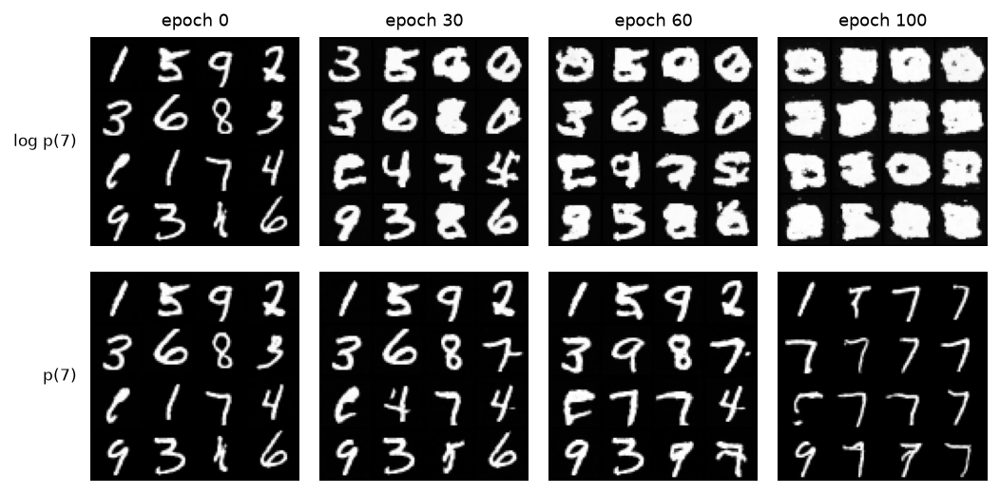
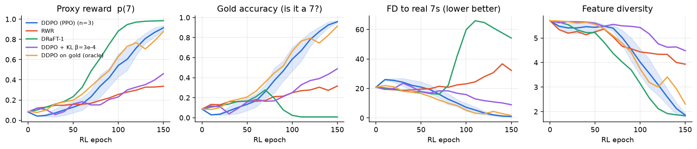
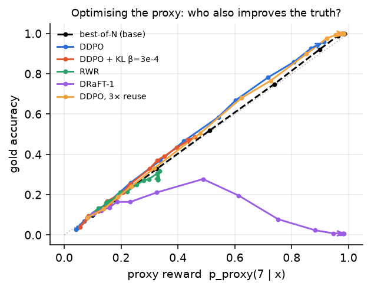
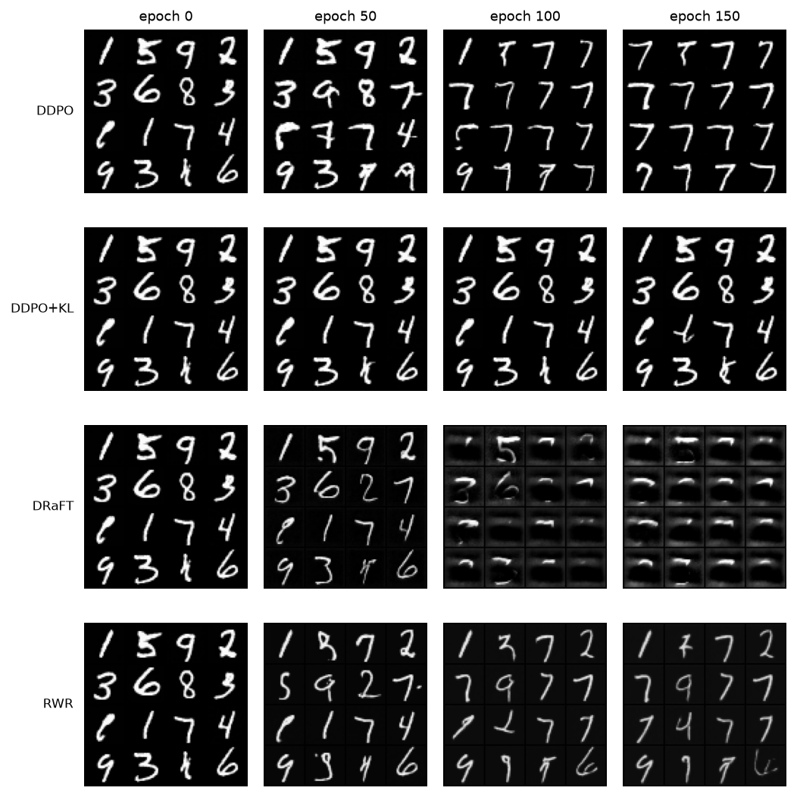
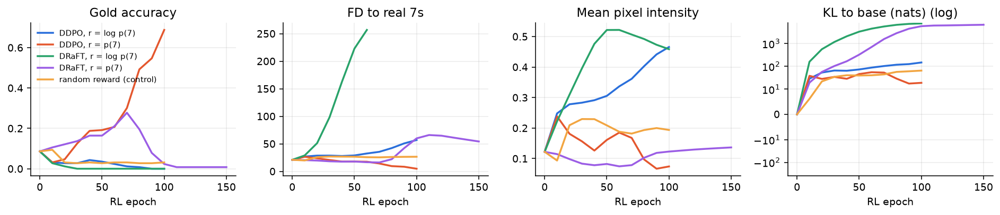
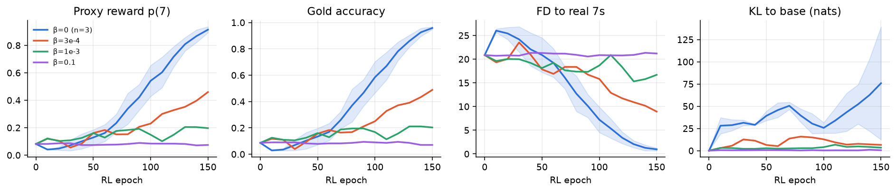
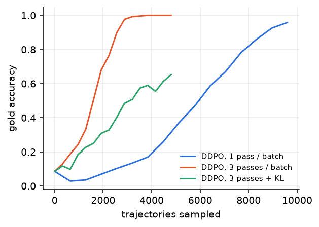
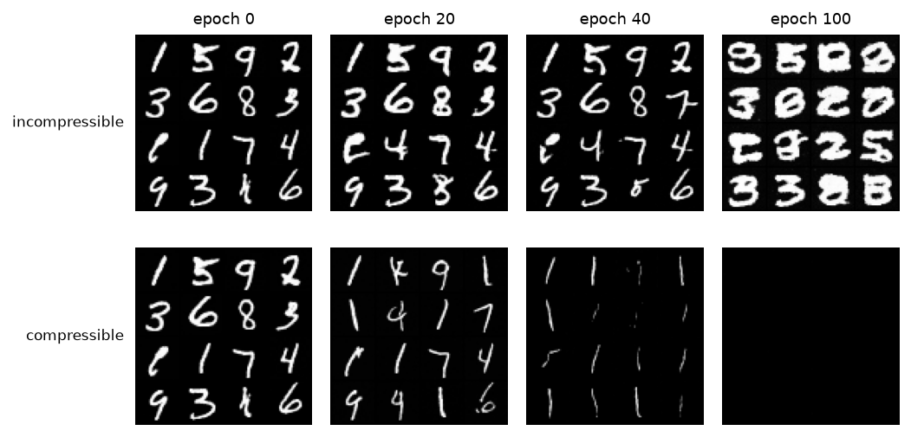

# When the reward model lies: RL fine-tuning of diffusion models, from first principles

*A controlled, laptop-scale study of DDPO, reward-weighted regression, direct reward backprop and
best-of-N. The goal is to see what each method does to the model, not just to its reward curve.*

---

## TL;DR

I built a small testbed where **reward hacking is directly measurable**. A diffusion model is
fine-tuned to maximise a deliberately weak *proxy* reward model and is scored by an independent
*gold* model the optimiser never sees. Then I ran the main families of diffusion RL against it.

1. **Policy-gradient RL (DDPO) is surprisingly robust to a bad reward model; gradient-based
   fine-tuning is not.** DDPO and DRaFT reached almost the same proxy score (0.91 vs 0.99). DDPO
   turned 9% → **96 ± 1%** of samples into real 7s (3 seeds). DRaFT turned **0.7 ± 0.2%** into 7s (3 seeds)
   while drifting about 6,500 nats from the base model. It found adversarial "ghost strokes" that fool the
   proxy MLP.
2. **Reward shaping decides the outcome before the algorithm does.** The same DDPO run with
   r = log p(7) instead of r = p(7) collapses into white blobs (gold accuracy 0%). Normalised
   policy gradients follow the dominant direction of reward *variance*, and with log p that is
   "add ink" rather than "be a 7".
3. **KL regularisation buys diversity at a steep price in reward, and best-of-N is hard to beat
   per nat.** Best-of-64 reaches 99% gold accuracy at 3.2 nats of exact KL. RL needs an order of
   magnitude more (upper-bound) path-KL for the same result. A KL penalty preserves diversity
   (4.5 vs 1.85) but slows learning sharply.
4. **Sample reuse gives about 3× sample efficiency for free, but not because of PPO.** Three
   passes per batch reach 98% gold accuracy after 2,880 trajectories, against 9,600 with a single
   pass. The measured importance ratios never leave [0.99, 1.01], so the ε = 0.2 clip never fires.
   Per-pixel log-prob averaging rescales DDPO's trust region by about 10⁴.
5. **Controls matter.** A random-reward control drifts 65 nats, so part of any "KL budget" is
   optimiser noise. The final low-noise denoising step can dominate both the gradient and the KL
   estimate unless you handle it.

*Fixed noise seeds, evaluated every few epochs during DDPO. Top: r = log p_proxy(7|x). Bottom: r = p_proxy(7|x).
Same algorithm, same hyper-parameters, same proxy model.*

---

## 1. Why RL for diffusion models?

Diffusion models are trained to imitate a data distribution. What we usually *want* is something
else: images that match a prompt, that people find aesthetic, that compress well, or (in science)
proteins that fold, molecules that bind and materials that are stable. These objectives are
**rewards**, often non-differentiable, often only available as a learned model, and never in the
pre-training loss.

Since 2023 there has been a fast-moving literature on closing this gap:

- **DDPO** (Black et al., 2023) treats denoising as an MDP and applies policy gradients.
- **DPOK** (Fan et al., 2023) adds a KL penalty to the pretrained model.
- **DRaFT / AlignProp** (Clark et al.; Prabhudesai et al., 2023) back-propagate the reward
  gradient through the sampler.
- **Reward-weighted regression / RAFT-style filtering** (Lee et al., 2023) fine-tune on
  high-reward samples.
- **Best-of-N** is the inference-time baseline that every method must beat.

Production systems for image models and generative protein design use variants of all of these.

The open question that interested me is the one that matters in practice: **the reward is almost
always a learned model, and learned models are wrong off-distribution.** Which methods improve the
*true* objective, and which merely find the reward model's blind spots? This is hard to study with
Stable Diffusion and a CLIP-aesthetic predictor, because there is no ground truth. So I built a
setting that has one.

## 2. A testbed where Goodhart's law is measurable

| Component | Choice | Why |
|---|---|---|
| Base model | 1.5M-param UNet DDPM, unconditional MNIST, 10k steps | Trains in under an hour on a laptop; produces all ten digits with about 9% 7s |
| **Proxy reward** | MLP trained on **1,000 labels**, 89.9% test accuracy. r = p(7 \| x) | Plays the role of a learned reward model: decent on-distribution, exploitable off it |
| **Gold evaluator** | CNN on all 60k labels + augmentation, 99.2% | The "true" objective. **Never used for training** (except in explicit oracle runs) |
| Feature network | Independent CNN, 99.0% | Fréchet distance to real 7s (FD) and feature diversity, not tied to either reward |
| Black-box reward | JPEG file size | Reproduces DDPO's (in)compressibility task; no gradient exists |

The task: **turn an unconditional digit generator into a 7 generator using only the proxy.**

Every run reports proxy reward, gold accuracy, FD to real 7s, feature diversity, and the
**path-space KL** to the pretrained model on a fixed set of 256 evaluation noise seeds.

## 3. Denoising is a sequential decision problem

A DDIM sampler with η = 1 generates an image by a chain
x_T → x_{t_{K-1}} → … → x_{t_1} → x̂₀, where each transition is Gaussian:

  π_θ(x_{t'} | x_t) = N( μ_θ(x_t, t), σ_t² I ).

Read this as an MDP:

- **state:** (x_t, t)
- **action:** the next, less noisy image
- **policy:** the denoiser
- **reward:** r(x̂₀), received only at the end

The key fact is that **log π_θ(x_{t'} | x_t) is exact and cheap**, even though the image
likelihood log p_θ(x₀) is intractable. That is all policy-gradient methods need.

**DDPO-SF (REINFORCE).**
  ∇J = E[ A(x̂₀) · Σ_k ∇ log π_θ(x_{t_{k+1}} | x_{t_k}) ],  with A = (r − mean r) / std r over the batch.

**DDPO-IS (PPO).** Re-use each batch for several updates with per-step ratios
ρ_k = π_θ / π_old and the clipped surrogate max(−Aρ_k, −A·clip(ρ_k, 1±ε)).

**KL to the pretrained model (DPOK-style).** Policy and reference share σ_t, so the per-step KL is
closed-form:

  KL_k = ‖μ_θ(x_t,t) − μ_ref(x_t,t)‖² / 2σ_t².

The path KL is the sum over steps. By the data-processing inequality it **upper-bounds** the KL
between final-image distributions. Keep that in mind when comparing with best-of-N, whose KL is
exact.

**RWR.** Weight your own samples by softmax(r/τ) and run weighted denoising score matching. This
is supervised learning on filtered data; it ignores the MDP structure.

**DRaFT-K.** If r is differentiable, back-propagate ∇ₓ r(x̂₀) through the last K sampling steps.
There is no RL and very low variance, so it is fast and, as we will see, very good at finding
adversarial examples.

All methods share the same base model, sampler (20 steps), batch size (64 trajectories per epoch),
optimiser (AdamW, learning rate 1e-5, full fine-tuning), and evaluation protocol.

## 4. Results

### 4.1 The headline: same proxy reward, opposite outcomes

| Method | proxy p(7) ↑ | gold acc ↑ | FD → real 7s ↓ | diversity ↑ | path-KL (nats) |
|---|---|---|---|---|---|
| Pretrained base | 0.081 | 0.086 | 20.85 | 5.71 | 0 |
| **DDPO (PPO-clip)**, 3 seeds | 0.914 ± 0.022 | **0.958 ± 0.010** | **0.96 ± 0.28** | 1.85 ± 0.07 | 76 ± 64 |
| DDPO + KL β=3e-4 | 0.460 | 0.488 | 8.93 | **4.49** | 7 |
| RWR | 0.336 | 0.316 | 32.26 | 3.93 | 697 |
| **DRaFT-1**, 3 seeds | **0.988 ± 0.003** | **0.007 ± 0.002** | 49.7 ± 4.5 | 1.81 ± 0.02 | 6,500 ± 300 |
| Oracle: DDPO on the gold model | 0.825 | 0.914 | 1.62 | 2.31 | 68 |
| Best-of-64 (no training) | 0.962 | 0.989 | – | – | 3.2 (exact) |

*All rows are final values after 150 epochs (9,600 sampled trajectories). Full table:
`runs/summary.md`.*

DRaFT wins the proxy race and loses everything else. The cleanest view is to plot the *true*
objective against the *optimised* one:

- **Best-of-N, DDPO, DDPO+KL and RWR all lie on the diagonal.** Every unit of proxy reward they
  gain is a real gain. This holds even though the proxy is a 1,000-label MLP.
- **DRaFT follows the diagonal up to a proxy score of about 0.5, then falls off a cliff.** The
  proxy keeps climbing to 0.99 while gold accuracy collapses to under 1%, identically across 3 seeds.

**Why the difference?** DDPO's update is a weighted average of the score function over *the
model's own samples*. It can only move probability mass toward images the model already
generates, and on those (in-distribution) images the proxy is roughly right. DRaFT's update is
∇ₓ r: it asks the reward model which pixel direction raises the score and goes there. For an MLP
that direction is an adversarial perturbation, the same mechanism behind adversarial examples.
DRaFT is, in effect, an adversarial attack on the reward model, amortised into the generator's
weights.

**Is it the reward model or the method?** I re-ran DRaFT against the strong, augmented gold CNN.
It now produces mostly recognisable 7s: FD to real 7s 20.8 → 9.0 and gold accuracy 0.76. That
score is circular, since it optimised gold. But the samples carry faint "ghost" overlays, the path
KL is still 3,560 nats, and the independent MLP rates only 31% of them as 7s. A more robust reward
model makes gradient-based fine-tuning work far better, but does not make it safe.

### 4.2 Reward shaping decides the outcome before the algorithm does

My first DDPO run used r = log p_proxy(7|x), the "natural" choice since it is the classifier's
log-likelihood. It failed completely: gold accuracy fell from 9% to 0%, and the samples became the
white blobs in the top row of the first figure. Changing only the reward to r = p(7|x) produced
96% real 7s.

The explanation is in the advantage normalisation. With 9% 7s in each batch, most of the variance
in log p(7) comes from the **91% of non-7s**. Among those, "a bit more ink" reliably makes
log p(7) slightly less negative (−9 → −6, say). Best-of-N ignores this because it only looks at
the top sample. A batch-normalised policy gradient follows the *dominant direction of reward
variance*, and that direction was ink. With the bounded p(7), non-7s all score about 0, so the
variance, and therefore the gradient, comes from the 7s.

The general lesson for practitioners: **a monotone transform of the reward does not change the
optimum, but it completely changes the optimisation path and therefore which optimum you reach.**

### 4.3 The price of staying close: KL regularisation

| β (KL weight) | gold acc | diversity | path-KL |
|---|---|---|---|
| 0 | 0.96 | 1.85 | 76 ± 64 |
| 3e-4 | 0.49 | 4.49 | 7 |
| 1e-3 | 0.20 | 5.53 | 3 |
| 0.1 | 0.07 | 5.70 | 1 |

- **Without a penalty, DDPO mode-seeks.** It produces near-perfect 7s, but feature diversity
  falls from 5.7 to 1.85: a handful of 7 styles.
- **A small penalty keeps most of the diversity** but makes learning much slower.
- **Too large a penalty freezes the model.**

**Best-of-N is the strongest baseline per nat.** Best-of-64 reaches 99% gold accuracy at an
*exact* KL of 3.2 nats. The RL runs reach comparable accuracy at path-KLs of 20–165. Part of that
gap is measurement: path-KL upper-bounds the marginal KL, and the random-reward control below
shows that tens of nats can come from optimiser noise alone. But the qualitative conclusion matches
Gao et al. (2022) for language models: **if inference compute is cheap, best-of-N is a very strong
baseline; RL earns its place by amortising that search into the weights.** Here that means 64×
cheaper sampling.

### 4.4 Sample reuse: PPO's importance weights are worth about 3×

Re-using each batch for three PPO passes reaches 98% gold accuracy after **2,880 trajectories,
against about 9,600** for one pass, at similar wall-clock time. Sampling is the expensive part of
diffusion RL, so this is the most practical knob I found.

A footnote that cost me a run: **with one pass per batch, DDPO-IS and DDPO-SF were bit-for-bit
identical.** DDPO averages the per-step log-prob over pixels (784 here, about 16k latents for
Stable Diffusion), which shrinks the log-ratios by that factor. I measured them directly:

- after one update, |ρ − 1| has a mean of 2e-4 and a maximum of 6e-3
- after six passes over the same batch the maximum is still under 0.01

With the textbook ε = 0.2 **the clip never activates, even with reuse.** The 3× gain above
therefore comes from extra gradient steps on slightly stale data, not from PPO's trust region.
This explains why the official DDPO configuration uses ε = 1e-4: the per-pixel averaging silently
rescales the trust region by four orders of magnitude.

### 4.5 Black-box rewards: where gradients don't exist

DRaFT cannot even be run on JPEG file size; DDPO does not care.

- **Rewarding incompressibility** (+30% file size) gives thicker, rougher strokes and a shift
  toward high-edge digits (0, 3, 8), replicating DDPO's original qualitative findings.
- **Rewarding compressibility** finds the degenerate optimum: digits thin into faint 1-like strokes,
  then over about 60 epochs every image fades to solid black. The most compressible image is no image. This is reward hacking in its purest
  form: the reward was satisfied exactly, and the result is useless.

### 4.6 Controls, gotchas and negative results

These took most of the time and are, I think, the most transferable part of the project.

1. **The last denoising step dominates everything.** With a 20-step cosine schedule ending at
   t = 0, the final stochastic step has σ ≈ 0.006. Its score term (x − μ)/σ² is about 100× larger
   than early steps, so it dominates gradient variance and the KL estimate (602 nats vs 7.7 with
   identical sample quality). Ending the stochastic chain at t = 20 fixed both.
2. **Null-reward control.** Running DDPO with random advantages moved the model 65 nats in 100
   epochs and nudged images slightly brighter, with no signal at all. Policy-gradient noise plus
   Adam's per-parameter normalisation performs a random walk in weight space. Any KL number for an
   RL-fine-tuned diffusion model should be read against this floor.
3. **x̂₀ clipping matters.** Removing the clip to [−1, 1] (to give clean gradients) wrecked 20-step
   sampling (FD 1.3 → 149). Keep it, and check with the null-reward control that it does not
   introduce a systematic drift.
4. **Learning rate is a reward-hacking knob.** At 3e-5 instead of 1e-5, DDPO on the proxy went
   straight to the blob solution (gold accuracy 0%). Faster optimisation reaches off-distribution
   regions before the policy-gradient "on-distribution" protection can help.

## 5. What I'd take to a real system

- **Prefer on-policy, score-function methods when the reward model is learned.** Use
  gradient-based fine-tuning (DRaFT, AlignProp, ReFL) only with robust or ensembled reward models
  and early stopping on a held-out evaluator.
- **Always hold out an evaluator the optimiser never sees.** In real systems that might be a second
  reward model, human raters, or (for protein design) an orthogonal structure predictor.
- **Treat reward shaping as a first-class hyper-parameter.** Bounded rewards and rank-based
  advantages focus the gradient on the tail you care about.
- **Report KL against a null-reward control, and compare to best-of-N at matched KL.**
- **Reuse samples with PPO;** it is the cheapest efficiency gain available.

**Next steps at scale:**
- the same protocol on Stable Diffusion with LoRA, using a weak and a strong aesthetic model as
  proxy and gold
- Diffusion-DPO and other preference methods in the same proxy-vs-gold harness
- reward-model ensembles as a defence against gradient hacking
- applying the testbed to structure-generating diffusion models (e.g. protein backbones), where the
  "gold" can be an independent folding model

## Reproducibility

All code is in this repository: about 800 lines of PyTorch, with no dependencies beyond
torch/torchvision/scipy. Every experiment is a single command (see `runs/queue.txt`). Fixed-seed
runs are deterministic on Apple MPS. The full study (base model, three classifiers and 20+ RL runs)
took about 5 hours on an M3 MacBook while sharing the machine with other work.
