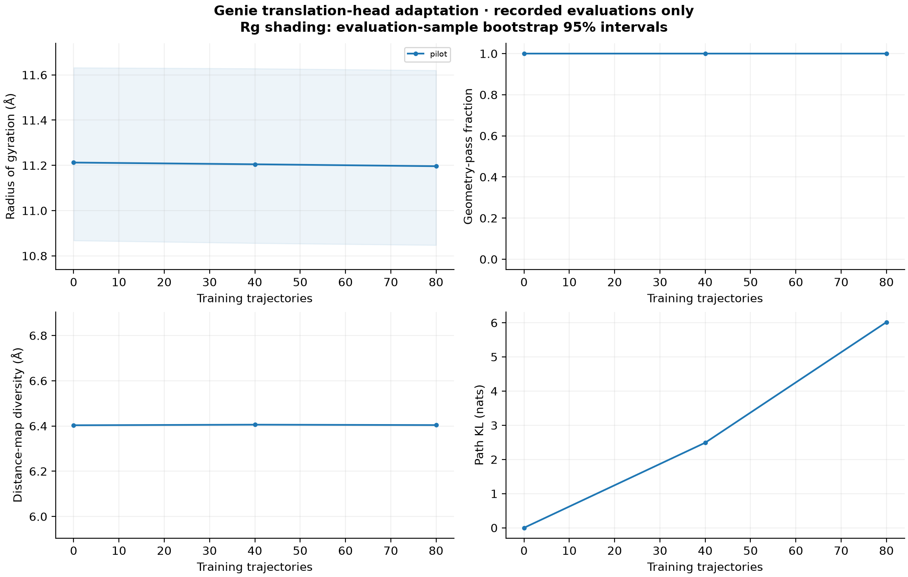
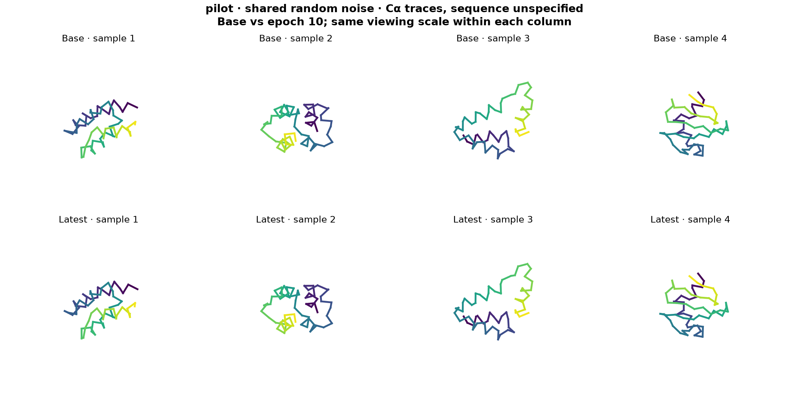

# Can 387 parameters steer a pretrained protein diffusion model?

*Follow-up: the user subsequently requested [GRPO directly on RFdiffusion3](../rfd3_grpo/README.md). That implementation now has a real-checkpoint smoke update and its own [method](../rfd3_grpo/METHOD.md) and [results](../rfd3_grpo/RESULTS.md). This draft describes the earlier Genie experiment and initial RFD3 source audit.*

*An executable study of policy-gradient adaptation, geometry proxies and the sampler details that matter when moving toward RFdiffusion3.*

**Experiment status:** the baseline and a short training pilot are running locally. The [results page](RESULTS.md) is generated from saved measurements and marks unfinished runs. The longer study includes independent training seeds, a random-reward control and best-of-N. This draft will be finalized after those runs; it does not assume that RL wins.

The question is deliberately narrow: can policy gradients make samples from a pretrained protein-backbone diffusion model more compact, without degrading simple geometry or collapsing structural diversity? Compactness is easy to measure and easy to misunderstand. A point cloud has an excellent radius of gyration. That does not make it a protein.

The aim is to demonstrate the machinery needed for a defensible research result: a real checkpoint, a stated objective, a likelihood that matches the sampler, controls, uncertainty and inspectable structures. The model is [Genie](https://arxiv.org/abs/2301.12485), a published protein-backbone diffusion model. RFdiffusion3 is a separate integration target examined at the source level. I do not use digit-generation results as evidence about proteins.

## What actually runs

The experiment loads the authors' SCOPe length-128 Genie checkpoint, with 4,087,574 parameters, and generates 64-residue Cα traces. It uses a 50-step stochastic DDIM sampler derived from the checkpoint's original 1,000-step cosine schedule. That respacing is an experimental choice: the baseline and adapted policies share it. It is not the original published sampling protocol.

The base network remains frozen except for an additive update equivalent to changing the final translation projection: a 3 × 128 matrix and three biases, or **387 trainable parameters**. Adaptation is enabled only for original timesteps between 50 and 600. Earlier, very noisy transitions and the last low-noise transitions remain frozen. The deterministic final decoder also stays frozen.

This small head is useful for two reasons. It keeps the compute budget manageable on an Apple laptop, and it makes the intervention unusually clear. We can change the actual pretrained weight rows and check that they produce the same means as the cached update. The numerical test does exactly that.

There is also a limitation: a small final head may not have enough capacity to learn a meaningful structural preference. A negative result here would not show that full-model or low-rank fine-tuning cannot work.

## Denoising as a policy

[DDPO](https://arxiv.org/abs/2305.13301) treats each denoising transition as an action. For the stochastic sampler used here,

\[
\pi_\theta(x_{t'}\mid x_t)=\mathcal N(\mu_\theta(x_t,t),\sigma_t^2 I).
\]

Genie's network supplies a coordinate prediction from which the noise estimate is obtained. The DDIM coefficients turn that estimate into the transition mean. The policy receives a reward after the final trace is produced.

The likelihood sums over all 3L coordinates:

\[
\log\pi_\theta=\sum_{i=1}^{3L}\left[-\frac{(x_i-\mu_{\theta,i})^2}{2\sigma_t^2}-\log\sigma_t-\tfrac12\log(2\pi)\right].
\]

A coordinate average would rescale the score-function gradient; inside an exponential importance ratio it would also change the ratio itself. This implementation uses the joint density and records the fraction of ratios that activate PPO clipping. That makes the trust-region behavior inspectable instead of inferred from an algorithm label.

The optimizer uses a leave-one-out reward baseline, batch standardization, clipped advantages, four passes over each collected batch, and a small conditional Gaussian KL penalty. The penalty is evaluated on collected states during training. Evaluation separately estimates the sum of conditional KLs on fresh adapted-policy trajectories.

The terminal decoder matters for that interpretation. Two policies can have identical stochastic transitions and different deterministic readouts. In that case a sum over only the stochastic transitions does not account for their full output difference. Here the decoder is shared, so the accumulated conditional KL describes the stochastic path distribution and provides the usual data-processing bound for its shared output map. It is still not directly comparable to a best-of-N marginal KL.

## A head update we can cache exactly

The last structure layer constructs a translation in a local coordinate frame. Let `s` be its frozen residue features and `R` its current frame. A translation-head delta has the form

\[
\Delta y_i=R_i(\Delta W s_i+\Delta b).
\]

The DDIM mean is linear in that final coordinate prediction. Once a rollout is collected, `s`, `R`, the reference mean and the scalar DDIM coefficient are sufficient to recompute the adapted means at its visited states. PPO reuse therefore needs only the small head, not another pass through the full denoiser. The next rollout still passes through the complete pretrained network: features are not assumed constant when coordinates change.

Seven numerical tests check the joint log density, Gaussian KL, gradient agreement with finite differences, frozen decoding, geometry diagnostics, frame parity and equivalence to direct pretrained-weight modification. During those checks, the upstream frame routine's implicit `torch.cross` axis gave an incorrect answer when the batch dimension happened to be three. The local vectorized version specifies the coordinate axis and is compared against singleton upstream calls.

## Reward and evaluation

The first reward is `−Rg / 10`, where Rg is the radius of gyration in Å. A second reward subtracts penalties for deviations from 3.8 Å adjacent Cα spacing and for nonlocal Cα clashes. These are simple geometric proxies, not estimates of stability or biological function.

For every evaluation, the code saves coordinates, per-sample metrics, four fixed-index PDB examples, elapsed time and the head checkpoint. It reports:

- Radius of gyration and the optimized reward.
- Adjacent-distance error and the fraction within a declared plausible range.
- Nonlocal clashes and a combined geometry-pass heuristic.
- Structural diversity from pairwise distances between distance maps.
- Path KL relative to the same frozen sampler.

Distance-map diversity removes dependence on global rotation and translation, but it also cannot distinguish mirror images. Neither it nor the geometry heuristic replaces a folding evaluation. A full designability study would add sequence design, an independent structure predictor and a comparison of predicted versus generated structures. Those stages are not performed here.

The run plan includes a random-reward control to measure optimizer drift, best-of-four selection to test whether simple sampling is sufficient, and three training seeds for the main objectives. Common evaluation noise makes checkpoint comparisons paired. Sample bootstrap intervals and variation across training seeds are different sources of uncertainty and are reported separately.

An exploratory ablation adapts earlier, noisier timesteps (200..999) with a smaller learning rate and a matching random-reward control. It was added after the pilot showed a very small change in radius. It tests whether the late-step restriction limits the effect; it is not a pre-registered confirmation experiment.

## Results and what they can support

The [live results table](RESULTS.md) and the figures below come directly from saved artifacts. Initial smoke sampling produced four finite 64-residue traces; all four passed the declared geometry filter. That validates a useful starting point, not the effectiveness of RL.

The decisive comparison is whether reward-directed runs improve Rg beyond the random control while preserving geometry and diversity across training seeds. If best-of-four achieves a better trade-off, that is a useful result: deploying adaptation would then require an amortization argument based on future sampling volume. Training and evaluation cost must be counted, not hidden behind the cheap final head.

Only completed runs support final comparisons. The pilot is exploratory and its repeated evaluation set is a validation set. Any stronger claim should be checked on fresh sampling seeds after choosing a configuration.

## Why RFdiffusion3 needs a separate sampler audit

The [pinned RFdiffusion3 sampler](https://github.com/RosettaCommons/foundry/blob/0d0b0ba44fab7ca76aa4b625c014ce5964c7d284/models/rfd3/src/rfd3/model/inference_sampler.py) adds churn noise before applying the denoiser and coordinate update. In mathematical terms, it samples `z = x + σε` and then applies a nonlinear `Fθ(z)`. The resulting transition is generally not Gaussian with mean `Fθ(x)` and variance `σ²I`.

This is an inference from the source, and it changes the implementation plan. Copying the Gaussian likelihood above into that sampler would optimize a likelihood that does not describe its actual actions. A legitimate extension could define and validate a new Gaussian transition, or use reward-weighted supervised adaptation instead. Both require an explicit baseline against the original sampler. The [integration note](RFD3_INTEGRATION.md) records those alternatives and the checks required before calling anything an RFD3 RL result.

## Reproduce and inspect

Start with [README.md](README.md). Source revision and checkpoint hashes, software versions, seeds, hyperparameters and source hashes are recorded in each run's `config.json`. The reporting script reads those artifacts; it has no hard-coded performance numbers. The existing MNIST study remains available as a separate experiment in the parent project.

This POC's contribution is a small, auditable bridge from diffusion-policy equations to an executed protein model. Its most important output is a comparison that can survive inspection, including the possibility that this adaptation does not beat sampling.
