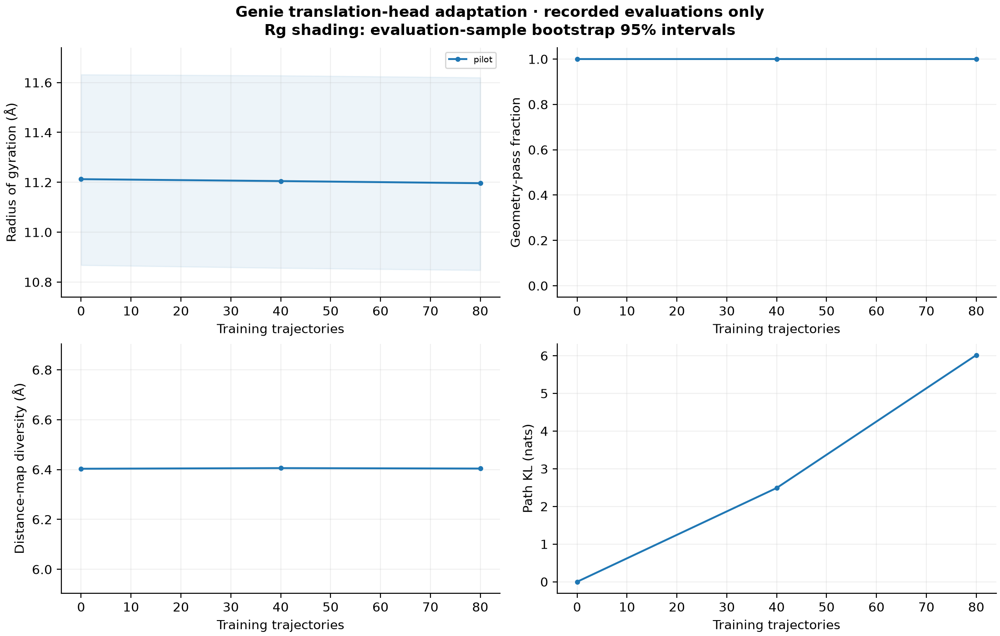
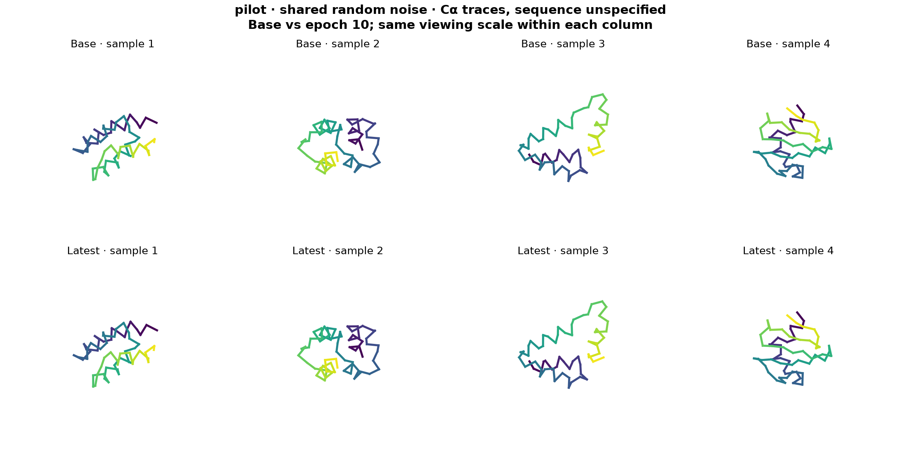

# Measured protein diffusion results

Generated 2026-11-13T03:15:37.016300+00:00 from on-disk metrics. Unfinished runs are marked partial; queue failures are identified when logged.

This report contains Genie SCOPe length-128 checkpoint experiments only. The subsequent RFdiffusion3 GRPO experiments are reported separately in ../rfd3_grpo/RESULTS.md.

| Run | State | Epoch | n eval | Rg (Å) ↓ | Geometry pass | Bond MAE (Å) ↓ | Diversity (Å) ↑ | Path KL (nats) |
|---|---|---:|---:|---:|---:|---:|---:|---:|
| pilot | complete | 10 | 16 | 11.196 | 100.0% | 0.0187 | 6.404 | 6.017 |

Geometry pass: ≥95% of adjacent Cα distances within 3.4–4.2 Å and no nonlocal Cα pair below 3 Å (sequence separation >2). These are declared heuristics, not foldability labels.
A displayed 100% pass rate is an observed fraction in a small sample, not a population success-rate guarantee. New-run metric logs also include a Wilson interval for this fraction.
Diversity is mean pairwise RMS difference of within-chain Cα distance maps. It is invariant to rigid motion, but also cannot distinguish mirror images.
Path KL is measured under the adapted policy against the same respaced frozen sampler. It is not a KL to the original 1,000-step Genie sampler. Best-of-N KL is deliberately not compared to this path quantity.

## Paired evaluation changes

Common random numbers pair the initial and latest checkpoint. Intervals below bootstrap evaluation samples, not independent training seeds; intermediate evaluations are exploratory.

- **pilot**: ΔRg = -0.016 Å, paired sample bootstrap 95% interval [-0.026, -0.007] Å; 80 training trajectories, 18.3 elapsed minutes through evaluation.

## Independent training seeds

- compact: fewer than two completed training seeds; no seed-level uncertainty reported.
- guarded: fewer than two completed training seeds; no seed-level uncertainty reported.
- random: fewer than two completed training seeds; no seed-level uncertainty reported.

## Fresh sampling seeds

Fresh-seed evaluation has not completed. Validation curves alone do not establish a final generalization result.

## Compute and comparison limits

All runs use float32. Each trajectory costs the configured number of denoiser evaluations; this cost plus training and evaluation trajectories is recorded in config/metrics. Best-of-4 uses four inference candidates per returned trace. Training is not free: an amortization claim needs the recorded training cost and the intended deployment volume.
The narrow head adaptation and small evaluation sets limit conclusions. No sequence design, folding-model validation, novelty search, all-atom checks or experimental validation has been performed. A no-change result is a valid outcome.

## Figures

