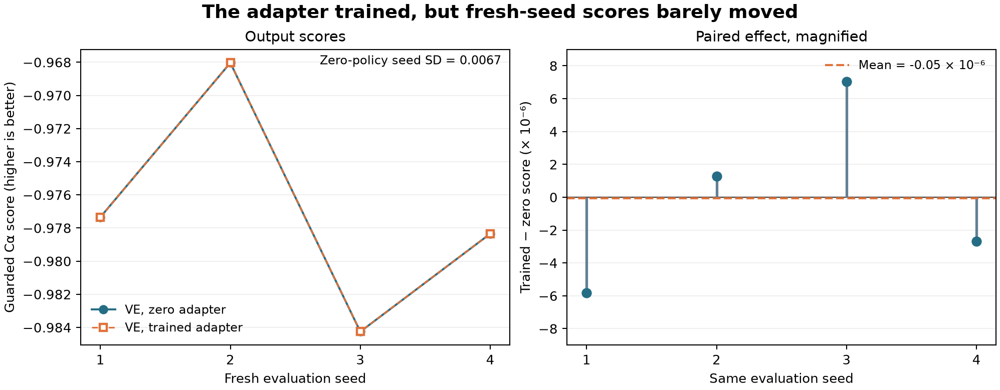

# I put a policy gradient on RFdiffusion3. The gradient worked; the geometry score did not improve.

The most revealing number in this experiment was **−0.00000005**. That was the average change in a Cα geometry score after I fine-tuned an RFdiffusion3 sampling policy and evaluated it on four fresh, paired random seeds. The adapter had changed. The outputs, for this metric, effectively had not.

I wanted to see whether a method inspired by [Flow-GRPO](https://proceedings.neurips.cc/paper_files/paper/2025/hash/3a10c46572628d58cb44fb705f25cbbf-Abstract-Conference.html) could update the diffusion component of a released [RFdiffusion3](https://pmc.ncbi.nlm.nih.gov/articles/PMC12458353.1/) checkpoint without retraining its 168-million-parameter denoiser. This is a useful experiment even with a null result, provided the distinction between “the gradient ran” and “the model improved” stays sharp.

## The question I actually tested

I gave RFD3 a PDB-conditioned motif-scaffolding task. For chain A of [1CRN](https://www.rcsb.org/structure/1CRN), residues 1 to 14 and 23 to 40 were fixed. The model generated eight residues in the gap. I scored the resulting Cα trace for overall size, bond-length error, and nonlocal clashes. The reward did **not** include the native coordinates of the missing gap.

The hypothesis was modest: a group-relative policy update should change the conditional distribution of denoising actions, and perhaps improve this geometry score on fresh samples. I kept the pretrained network frozen so I could isolate the effect of a small adapter. The primary control was the same stochastic sampler with its adapter set to zero, evaluated on the same seeds. Stock RFD3 was also sampled, but its different sampling dynamics make it a reference, not a clean estimate of the RL effect.

## Translating Flow-GRPO to an EDM denoiser

Flow-GRPO was developed for flow-matching models. Its paper converts a deterministic flow ODE into an SDE so that each denoising step has a tractable action density. RFdiffusion3 uses an EDM-style denoiser and a different stock sampler. Copying the paper's rectified-flow update into RFD3 would have given me the wrong stochastic process.

I instead used the denoiser \(D_\theta(x,\sigma)\) to form the usual approximate score, \((D_\theta-x)/\sigma^2\), then defined a variance-exploding reverse-SDE step motivated by [score-based SDEs](https://arxiv.org/abs/2011.13456) and [EDM](https://arxiv.org/abs/2206.00364). With a noise setting of 0.1, unfixed coordinates receive Gaussian noise as the noise scale falls. A zero-noise numerical check recovers the corresponding EDM Euler step. The new policy therefore has a Gaussian *conditional transition* density, which is exactly the density needed for a per-step old/new policy ratio and reference KL.

The transition density is exact for **my modified sampler**. Stock RFD3 follows different dynamics. The clipped, per-step policy ratios are a training surrogate, and I did not calculate an exact likelihood for the final protein structure. Continuous-time SDE and probability-flow equivalence assumes an exact score; the learned score and finite steps used here do not provide a marginal-equivalence guarantee. Those distinctions determined which comparisons I was willing to make.

My trainable part had only 786 parameters: a rank-two adapter with three noise-level bands. It changed the mean update for free Cα atoms on the last recycling pass. Fixed motif coordinates stayed fixed; the denoiser's parameters did not change. At each update I sampled four sibling structures under the same 1CRN condition, centered and scaled their terminal rewards within that group, then optimized clipped action ratios with a reference KL penalty. Three groups meant twelve training trajectories in total.

## What the run showed

The policy update was real. All three training groups had nonzero relative advantages, adapter weights moved, and the frozen backbone had zero gradients. The final adapter delta norm was 0.00259. The largest logged absolute per-step log ratio during an update was 0.00854. Eight numerical tests passed, including checks of Gaussian ratios and the zero-noise sampler limit.

I predeclared four new evaluation seeds for each of three structures: 1CRN for the training condition, plus [1PGA](https://www.rcsb.org/structure/1PGA) and [1UBQ](https://www.rcsb.org/structure/1UBQ) as conditions held out from **this RL run**. The complete 1CRN block contains four stock, four zero-adapter, and four trained-adapter samples. On its four paired trained-versus-zero seeds:

| 1CRN metric | Trained minus zero adapter |
|:--|--:|
| Mean guarded Cα score | −0.00000005 |
| Seed-bootstrap interval for that mean | [−0.00000425, +0.00000460] |
| Mean gap-to-native Cα RMSD | −0.000022 Å |
| Geometry checks passed | 12 of 12 samples across all three policies |

The zero-adapter score varied across seeds with a standard deviation of **0.0067**. The largest absolute trained-versus-zero shift on an individual seed was about **0.000007**. The figure makes that scale difference visible.

The evaluation deadline stopped the larger benchmark at **17 of 36** planned samples. There is only one trained-versus-zero pair for 1PGA and none for 1UBQ. That one 1PGA score difference was +0.00000122, but it is not a held-out result I would generalize from. I did not fill in the missing samples after the deadline and call the result confirmatory. The [full table](RESULTS.md) marks every missing cell.

## What I would change next

The geometry reward may have been a poor lever for this specific task. Eight generated residues sit inside a 40-residue trace with 32 fixed residues, yet the score averages global size and bond errors over the whole trace. A loop-specific signal could be stronger. The 786-parameter adapter and three-group training budget may also have limited the attainable shift. These are hypotheses suggested by the setup and tiny measured action changes, not explanations proved by this run.

A second study should prospectively define a sharper gap-focused reward, use several training motifs, and finish an adequately sized held-out evaluation. It would need independent checks of all-atom quality and sequence designability before saying anything about protein-design performance. The current gap-to-native RMSD is only descriptive because the generated segment has no specified sequence or unique native target. The two test PDBs were held out from my RL updates; I have not established that they were absent from RFD3's original pretraining set.

I could make a real RFD3 denoising policy stochastic, compute its conditional action ratios, and train a frozen-backbone adapter with group-relative rewards. Under this reward and compute budget, that training made no measurable improvement in the completed fresh-seed test. The [predeclared protocol](PROTOCOL.json), [pinned checkpoint and run configuration](train_1crn/config.json), [implementation](../rfd3_grpo/grpo.py), [coordinate audit and results](RESULTS.md), and [run notes](STATUS.md) make both parts of that conclusion inspectable.
