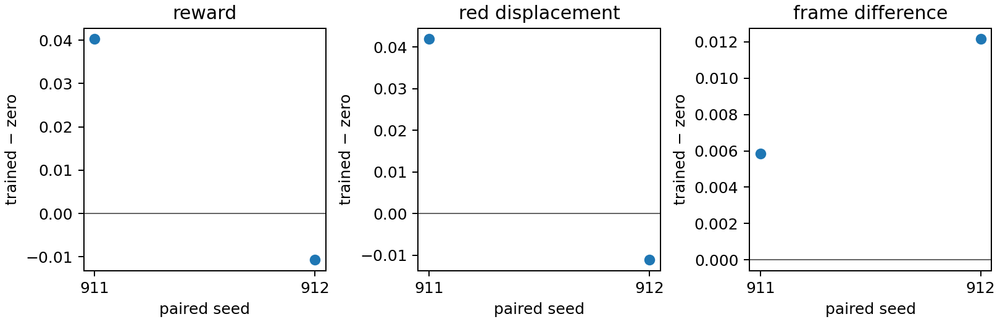

# Can group-relative RL improve a text-to-video diffusion model on a laptop?

*One-update research pilot on a pretrained model, not a claim of cinematic video quality. Results below come from the [audited raw artifacts](runs/red_ball_residual_grpo_v1/RESULTS.md).*

The question is narrow: can I perform an actual policy-gradient update on a pretrained text-to-video denoiser, within 16 GB of shared Apple memory, and measure whether that update changes a declared video reward on fresh seeds? This is harder than low-precision inference. Training needs the denoiser's activation graph, four sampled trajectories, and repeated forward passes for policy ratios. An output that merely looks different would not establish that the update improved anything.

I chose the pinned [ZeroScope v2 576w](https://huggingface.co/cerspense/zeroscope_v2_576w) checkpoint (revision `6963642a64dbefa93663d1ecebb4ceda2d9ecb28`). The model card describes a 24-frame, 576×320 training setup and a noncommercial CC-BY-NC-4.0 license. The native-length inference path exceeded the laptop's MPS memory cap. At 16 frames, fp16 ran but produced non-finite decoded frames. A first-step diagnostic showed the bfloat16 U-Net itself returned all-NaN predictions. Float32 computation solved that numerical failure at eight frames and 320×192, producing finite red spheres. The output missed the requested *single* sphere and plain floor, so I kept prompt fidelity separate from the red-motion reward.

The pilot policy is **not the stock ZeroScope sampler**. I use 16 stochastic DDIM reverse steps (`eta=0.5`) at eight frames and 320×192. Each transition has a Gaussian conditional density under the model's predicted noise and the pinned DDIM schedule. I checked its mean, variance, log density, and gradient against the scheduler numerically. A zero-adapter sample from this modified sampler was finite and still showed recognizable red spheres with modest temporal motion. That density is for a *latent action conditioned on its current latent and prompt*; it is not an exact likelihood of the final decoded video.

The 1.4-billion-parameter 3D U-Net backbone stays frozen in float32. I first tried a rank-4 internal LoRA. A real backward pass exceeded the bounded MPS memory cap at visually useful eight-frame settings, even with attention slicing and activation recomputation. Four-frame probes could fit, but their sampled clips were visibly too degraded. I kept those failed probes and changed the trainable part *before any RL training*: a zero-initialized 5,204-parameter 3D convolutional residual on the U-Net's text-conditional noise prediction. The unconditional classifier-free guidance branch remains frozen. This is a parameter-efficient **output adaptation of the diffusion policy**, not internal LoRA fine-tuning of ZeroScope.

For one fixed prompt, I collected four independent stochastic trajectories and scored a declared red-object rightward-motion proxy. I subtracted the group mean and divided by the within-group standard deviation. I saved the latent state and action at **one selected middle reverse step per trajectory**, then performed one clipped policy-ratio update using those four conditional Gaussian log densities. This follows the denoising-as-decision-process view in [DDPO](https://arxiv.org/abs/2305.13301), but it is a deliberately sparse GRPO-style surrogate, not a full-trajectory policy-gradient estimate. The reference policy's KL at the initial update point was zero by construction; no KL penalty was optimized. It is **diffusion-policy GRPO**, not the [Flow-GRPO](https://arxiv.org/abs/2505.05470) algorithm for flow-matching models. The earlier [RFdiffusion3 study](../rfd3_flow_benchmark/BLOG_POST.md) used a different continuous-time sampler and conditioning problem; similar group-relative updates do not make the underlying policies identical.

The reward is intentionally simple enough to audit: red-pixel visibility times rightward centroid displacement, with a small temporal-jerk penalty. It is vulnerable to color and flicker hacks. I therefore inspect the raw clips, red visibility, frame difference, and paired fresh-seed trained-minus-zero-adapter scores. These checks use the same simple color heuristic and are not an independent perceptual evaluator. A higher proxy reward alone would not establish prompt fidelity or good video quality. Two evaluation seeds in this pilot cannot support a generalization claim; they are a feasibility check for a larger, held-out prompt study.

I selected MSR-VTT as a candidate for a later caption-split benchmark, but this pilot uses one predeclared synthetic prompt and no MSR-VTT examples. The evaluation seeds were fresh, but the text prompt was not held out. This is not a dataset benchmark.

## Results

- **Stock and stochastic eight-frame visual gates:** both produced finite red spheres. The single-object, plain-floor semantics of the prompt failed.
- **Internal LoRA backward:** exceeded the MPS memory cap at the usable eight-frame setting, so no LoRA training was run.
- **The update itself:** the four training trajectories scored +0.00043, −0.0380, +0.0548 and +0.0383. That gave nonzero group advantages (−0.38, −1.45, +1.14, +0.68). Every recorded transition re-evaluated to a ratio of exactly 1.0 before the update, as an on-policy step should. Gradient norm before clipping was 3,349, the adapter moved by 0.0125 in parameter norm, and the frozen U-Net received no gradients. Peak MPS driver allocation was 7.8 GB. Training plus evaluation took 19.4 minutes.
- **Fresh-seed trained vs zero-adapter (same noise):** reward changed by +0.040 on seed 911 and −0.011 on seed 912 (mean +0.015). Red visibility fell on both seeds (−0.23, −0.17). In the seed-911 filmstrip, the trained clip shows more striped background artifacts than its zero-adapter twin. The comparison isolates the adapter under the same modified sampler; the untouched stock sampler is a separate visual gate.
- **Interpretation:** a single update with two evaluation seeds cannot show an improvement, and none is claimed. The mixed reward change and the consistent visibility drop are better read as evidence that even a tiny output residual visibly perturbs ZeroScope's samples. A useful follow-up needs many updates, more prompts and many more paired seeds, which the 16 GB laptop can only do slowly (about 2.5 minutes per eight-frame trajectory).

The result I would trust is one I can trace from pinned weights and seeds through raw frames, transition log probabilities, a nonzero finite adapter update, and paired fresh-seed outcomes. Every link in that chain now exists for this pilot. What it shows is that a real text-to-video GRPO update is feasible on this laptop. It does not show that the update helped.

The [zero-adapter clip for seed 911](runs/red_ball_residual_grpo_v1/zero_eval_seed_911/clip.gif) and [trained clip for seed 911](runs/red_ball_residual_grpo_v1/trained_eval_seed_911/clip.gif) are saved beside the [reproduction protocol](PILOT_PROTOCOL.json) and [implementation](video_grpo_pilot.py). The checkpoint weights and hashes are recorded in [model selection](SELECTION.md). The stock checkpoint and the output residual carry the model's noncommercial license; this post reports an experiment rather than releasing a commercial model.
