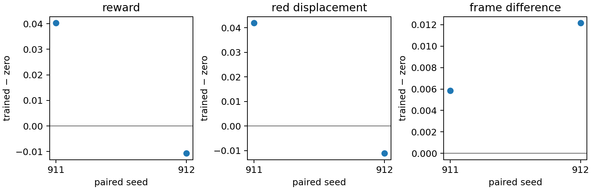

# ZeroScope GRPO pilot: audited results

Status: complete; 4 training trajectories, 2 paired fresh evaluation seeds, one optimizer update.

This is an exploratory, one-prompt, eight-frame pilot. The output residual is trained; the pretrained ZeroScope U-Net is frozen. Scores concern red-object centroid motion, not text adherence or video quality. The model visibly renders multiple red spheres instead of the requested single ball on a plain floor.

| Fresh seed | Zero reward | Trained reward | Trained − zero |
|---:|---:|---:|---:|
| 911 | -0.066759 | -0.026513 | +0.040246 |
| 912 | +0.004026 | -0.006642 | -0.010668 |

| Metric | Mean trained − zero | Per-seed differences |
|---|---:|---|
| reward | +0.014789 | +0.040246, -0.010668 |
| red_visibility | -0.197885 | -0.225090, -0.170680 |
| red_displacement | +0.015424 | +0.041902, -0.011053 |
| center_jerk | +0.006465 | +0.009005, +0.003926 |
| frame_difference | +0.009008 | +0.005861, +0.012154 |

With two fresh seeds, these are descriptive paired differences, not a confidence interval or a generalization claim.

Adapter delta norm: 0.0124852; gradient norm before clipping: 3349.46; frozen U-Net gradients: 0.

All saved raw videos were finite, shape-checked, independently re-scored, and hashed. The table below records the raw-frame pixel hashes.

| Clip | SHA-256 of uint8 pixels |
|---|---|
| train_0_seed_311 | `8445d4c1a7f502b3545e41a94c7c6351f2139c2e2db8caeb864c3955ffe23ac0` |
| train_1_seed_312 | `7bc24430578a9f469fc7111da9abce6c864db886a0fc8a29bf3a94ea76ca5df5` |
| train_2_seed_313 | `3a0b79e9dc57a3b1868629da406eb581c568d7fd094c4eecee7b105e3421fbb1` |
| train_3_seed_314 | `19f7597044a6539f097b518614b6f61175c783127f6d621d01a580604338e9e7` |
| trained_eval_seed_911 | `2964e76f87ef58074faa0e2183a3eb176d74628b838a6399d6e3033dac779173` |
| trained_eval_seed_912 | `634c26c6270c5ee49111f1f49b4d4abe29fb233775d8b92d1889014706f84f99` |
| zero_eval_seed_911 | `3fafed2b14f7aad1c35e2301a4e0dd253be9c6076e3a47a699e55072134d4319` |
| zero_eval_seed_912 | `28e4f0d8ec1ac29ef55137fdb358dcde7f53913791821fb64d627d0e37144d9d` |

